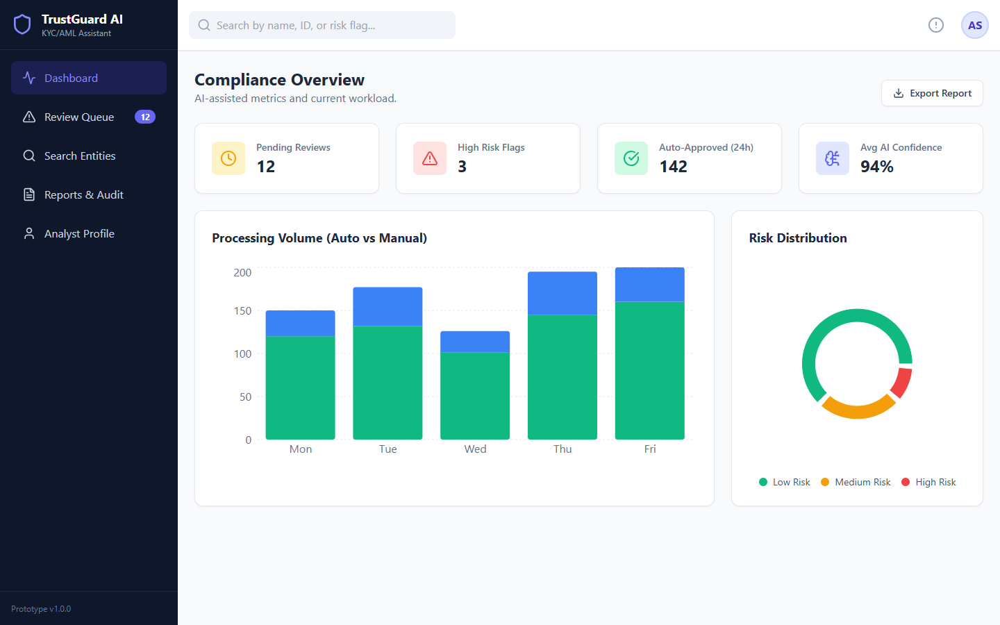

# TrustGuard AI: AI-Assisted KYC/AML Onboarding & Compliance Review

## Product Overview
TrustGuard AI is a comprehensive FinTech prototype designed to streamline Customer Due Diligence (CDD) and Anti-Money Laundering (AML) processes. It acts as an "AI Copilot" for compliance teams, processing customer onboarding data, simulating verification, aggregating risk indicators, and summarizing cases to reduce manual review times while maintaining regulatory rigor.

## Why I Built This & Problem Statement
**The KYC Problem:** Traditional customer onboarding is friction-heavy, requiring days or weeks for manual document verification, leading to high drop-off rates and poor user experience.
**The AML Problem:** Compliance teams drown in "false positives" from legacy rules-based transaction monitoring and sanctions screening, leading to alert fatigue, high operational costs, and delayed decisions. 

I built TrustGuard AI to demonstrate how a Human-in-the-Loop (HITL) AI system can parse complex onboarding data, cross-reference synthetic sanctions/PEP databases, and synthesize findings into an actionable summary, effectively balancing rapid onboarding with strict compliance.

## Product Goals & Hypothesis
**Goal:** Reduce manual case review time by 60% without increasing false negatives (missed risks).
**Hypothesis:** By employing LLM-based case summarization and pre-computing risk scores based on aggregated flags, compliance analysts can make faster, more accurate decisions compared to manually reviewing disjointed documents and database hits.

## User Journey & Workflow
1. **Customer Onboarding:** User submits ID, Proof of Address, and company structure (if corporate).
2. **Information Collection:** System aggregates submitted data.
3. **Document Verification (Simulation):** Checks ID authenticity, matches faces.
4. **Risk Indicators & Sanctions/PEP (Simulation):** Checks synthetic databases for sanctions, adverse media, and Politically Exposed Persons (PEPs).
5. **KYC Review Queue:** Cases are routed based on automated risk scores (e.g., Low risk = auto-approved; High risk = manual review).
6. **AI Case Summary:** System generates a natural language summary and recommendation.
7. **Analyst Decision:** Analyst reviews the AI summary, examines flagged items, and inputs a decision (Approve/Reject/Escalate).
8. **Audit Trail:** Every automated check and human action is immutably logged for regulatory exams.

## Key Considerations & Tradeoffs
- **Human-in-the-Loop (HITL):** Pure auto-rejection of high-risk cases poses legal and customer-service risks. HITL ensures a human makes the final call on complex cases, satisfying regulatory expectations.
- **Explainability:** Black-box ML models are unacceptable in compliance. TrustGuard AI uses transparent rules for initial flagging and uses AI purely for summarization and feature extraction, keeping the decision rationale clear.
- **False Positives:** Tuned the synthetic thresholds to tolerate some false positives rather than risk a false negative (missing a true money launderer).
- **Compliance vs. Product Tradeoffs:** Faster onboarding (Product) often conflicts with deep vetting (Compliance). The AI summary bridges this gap by speeding up the manual vetting phase.
- **Privacy & Security:** Designed with data minimization in mind; role-based access control (RBAC) principles are implied for the UI.

## KPIs & Metrics
- **Average Handling Time (AHT):** Time taken per manual review.
- **Auto-Approval Rate:** Percentage of low-risk users onboarded without human intervention.
- **False Positive Escalation Rate:** Percentage of L1 escalations that L2 deems safe.

## Architecture & Tech Stack
- **Frontend:** React, TypeScript, Vite, Tailwind CSS
- **UI Components:** Lucide React (Icons), Recharts (Data Visualization)
- **State Management:** React Hooks
- **Data:** Synthetic embedded JSON data (no real PII or live databases)

## Roadmap & Future Opportunities
- **V1 (MVP - Current):** Static prototype demonstrating the UI, queue, and AI summary concept.
- **V2:** Integration with real LLM APIs (OpenAI/Anthropic) to dynamically generate summaries from raw JSON payloads.
- **V3:** Connecting to a sandbox verification provider (e.g., Onfido, Persona) for live document testing.

### Project Structure
- `/src/App.tsx`: Main dashboard and routing logic.
- `/src/index.css`: Tailwind configuration and global styles.

## Screenshots
*(Add screenshots to the `screenshots/` directory)*
- `screenshots/dashboard.png` - Analytics and Volume
- `screenshots/queue.png` - Case Review Queue
- `screenshots/case-detail.png` - AI Summary and Audit Trail

## Limitations & Future Improvements
- Currently relies on hardcoded synthetic data.
- Does not persist state across reloads.
- Responsive design is optimized for desktop (standard compliance environment).
